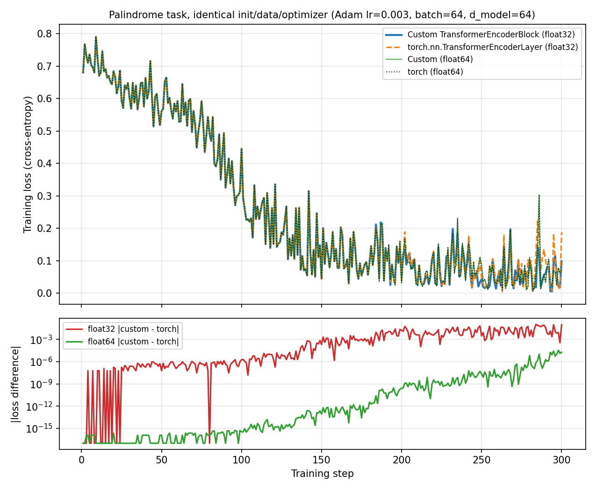

# TrioFormer — Transformer Comparison Service

> A three-cloud service (**Streamlit UI ⇄ FastAPI Model API ⇄ Supabase Data**) that serves three small
> pretrained transformers — BERT, GPT-2 and T5 — through plain PyTorch and Hugging Face Transformers, plus a
> **from-scratch tiny Transformer encoder** (positional encoding + multi-head self-attention) with per-head
> attention heatmaps. The from-scratch encoder was originally built as the "Former-It" palindrome classifier;
> its endpoints are kept as the legacy API below.

## Live deployment URLs

| Tier | Platform | URL |
|------|----------|-----|
| **Repository** | GitHub | https://github.com/emmabellerogo/cst-435-topic-5-trioformer |
| **API (FastAPI backend)** | Render Free | https://former-it-api.onrender.com |
| **API documentation** | Render Free (`/docs`) | https://former-it-api.onrender.com/docs |
| **Data** | Supabase | https://hutifztunklvgvilickm.supabase.co |

> The Render service is deployed and live-tested. **Streamlit is out of scope for Product 5:** the Streamlit interface
> belongs to Product 5B: TrioDeck, so no UI URL is listed here.

---

## What it does (legacy Former-It encoder)

The original Former-It part of the service decides whether a short symbol sequence is a **palindrome** using a
Transformer encoder built from scratch, and — crucially — returns the
**per-layer, per-head self-attention matrices** so you can see *which positions
attend to which*. Because the palindrome rule compares position `i` with position
`n-1-i`, a self-attention head can learn the **anti-diagonal**, which the heatmaps
make visible. You pick the learning rate, batch size, and epochs; the API trains
with Adam + cross-entropy, reports held-out **accuracy / macro-F1**, and persists
every run. The UI lets you train, type or generate a sequence to classify, view
the attention heatmaps, review run history, and read the model card. Only the
sequence's **sha256 hash** is logged — never the symbols.

## What changed from the base template (the reusable pattern in action)

The Former-It encoder was built from an earlier three-cloud regression template (*Regress-It*). The
three-cloud split and file layout are the same; only the middle box changed:

| Aspect | Regress-It | Former-It |
|--------|----------------------|---------------------|
| Model | `nn.Linear(1,1)` + SGD | from-scratch Transformer encoder + Adam |
| Task | regression | palindrome vs random (binary) |
| Metrics | MSE / MAE / R² | accuracy / macro-F1 |
| Input | one scalar `x` | a sequence of symbol ids |
| Explainability | — | **per-head self-attention heatmaps** |
| Extra endpoints | — | `/predict_sample`, `/classes` |
| Privacy invariant | — | store sequence **hash**, never symbols |
| Tables | datasets · runs · predictions | datasets · runs · **run_artifacts** · sequence_metadata |

Everything else — UI as a thin client (no torch), API as the only writer,
Supabase as the single source of truth, service-role vs anon keys, RLS on
`runs`, the four test categories — is unchanged.

## Architecture

```
┌──────────────────────┐   HTTPS/JSON    ┌──────────────────────────┐   service-role   ┌──────────────────┐
│  Streamlit Cloud     │ ──────────────► │  FastAPI on Render        │ ───────────────► │  Supabase        │
│  (ui/app.py)         │   symbol seq    │  (api/main.py)            │   full access    │  Postgres        │
│  thin client, no ML  │                 │  Pretrained BERT/GPT-2/T5 │                  │  datasets/runs/  │
│  plots attn heatmaps │                 │  + from-scratch encoder   │                  │  run_artifacts/  │
│                      │ ◄────anon key,  │                          │                  │  sequence_       │
│                      │   read-only ────┼──────────────────────────┼──────────────────►│  metadata        │
└──────────────────────┘   SELECT runs   └──────────────────────────┘                  │  (RLS: anon can  │
                                                                                        │   only SELECT    │
                                                                                        │   runs)          │
                                                                                        └──────────────────┘
```

## Project structure

```
cst-435-topic-5-trioformer/
├── README.md                 # This file
├── MODEL_CARD.md             # Model details, attention, privacy, limitations
├── shared/
│   ├── schemas.py            # Pydantic API contract
│   └── data.py               # Synthetic palindrome sequence generator + class contract
├── api/                      # FastAPI tier (deploys to Render)
│   ├── main.py               # Endpoints
│   ├── model_pipelines.py    # Pretrained BERT / GPT-2 / T5 inference (one model resident at a time)
│   ├── encoder_demo.py       # Educational attention heatmaps from our own encoder
│   ├── training.py           # From-scratch Transformer encoder + artifact (de)serialization
│   ├── db.py                 # Supabase (service-role) data access
│   ├── configs/default.yaml
│   └── requirements.txt
├── ui/
│   ├── app.py                # 5-tab thin client (type / generate + attention heatmaps)
│   ├── requirements.txt      # No torch (matplotlib only, for heatmaps)
│   └── .streamlit/secrets.toml.example
├── db/
│   ├── migrations/001_init.sql
│   └── seed.py
├── src/transformer.py        # The from-scratch Transformer encoder
├── benchmarks/               # Custom encoder vs torch.nn encoder benchmark
├── scripts/
│   ├── download_models.py    # Fetch the 3 checkpoints from the Hugging Face Hub (Render build step)
│   └── linux_check/          # Render-like 512 MB Linux memory check (run by .github/workflows)
├── tests/                    # pytest suite
├── render.yaml               # Render blueprint
└── requirements-dev.txt
```

## Quickstart (local)

```bash
cd cst-435-topic-5-trioformer

python -m venv .venv && source .venv/bin/activate
pip install -r requirements-dev.txt

pytest -q            # tests pass; the live-Supabase test skips without creds.
                     # (the first `pip install` downloads CPU PyTorch, ~200 MB; real-model smoke test is opt-in:
                     #  RUN_HF_SMOKE_DOWNLOAD=1 pytest tests/test_model_pipelines_smoke.py -s)

# create .env in the repo root with SUPABASE_URL and SUPABASE_SERVICE_KEY (never commit it)
cp ui/.streamlit/secrets.toml.example ui/.streamlit/secrets.toml

uvicorn api.main:app --reload --port 8000              # terminal 1
streamlit run ui/app.py                                # terminal 2
```

To deploy to the three clouds: apply `db/migrations/001_init.sql` and `002_trioformer.sql` in the Supabase
SQL Editor, deploy the API from `render.yaml` on Render (see *Deploying the API to Render Free* below), then
deploy `ui/app.py` on Streamlit Community Cloud with the secrets listed in
`ui/.streamlit/secrets.toml.example`.

## API endpoints

| Method | Path | Purpose |
|--------|------|---------|
| `POST` | `/datasets` | Register a synthetic sequence dataset (params only) |
| `POST` | `/train` | Train the Transformer, persist run + model artifact, return metrics |
| `GET`  | `/runs/{run_id}` | Fetch one run |
| `GET`  | `/runs` | List recent runs |
| `POST` | `/predict` | Classify a symbol sequence; return per-head attention; log the hash |
| `POST` | `/predict_sample` | Generate + classify a sample; return attention |
| `GET`  | `/classes` | The class labels the model predicts over |
| `GET`  | `/healthz` | Liveness / DB ping / resident model |
| `GET`  | `/version` | Build SHA + torch / transformers version + checkpoints |

### TrioFormer endpoints (pretrained BERT, GPT-2 and T5 + our own encoder)

| Method | Path | Model | Purpose |
|--------|------|-------|---------|
| `POST` | `/bert_fillmask` | `prajjwal1/bert-small` | Masked-token prediction for one `[MASK]` |
| `POST` | `/gpt2_continue` | `erwanf/gpt2-mini` | Greedy text continuation |
| `POST` | `/t5_summarize` | `t5-small` | Abstractive summarization (`summarize:` prefix, beam search) |
| `POST` | `/encoder_attention` | our `src/transformer.py` (untrained) | Educational per-head attention heatmap |
| `GET`  | `/benchmarks` | – | Per-model latency statistics from Supabase |

Every pretrained call logs only the SHA-256 of the input, the model name, the output and the server-side
latency to Supabase (`inputs` / `inferences`). The models are loaded with plain PyTorch + Hugging Face
Transformers (no ONNX, no quantization, no custom export) and are **deliberately small** so the whole
service fits Render Free:

| Task | Checkpoint | Params | Size (fp32) | Context |
|------|------------|--------|-------------|---------|
| BERT masked-token | `prajjwal1/bert-small` | 28.8 M | 115 MB | 512 |
| GPT-2 continuation | `erwanf/gpt2-mini` | 38.6 M | 154 MB | 512 |
| T5 summarization | `t5-small` | 60.5 M | 242 MB | 512 in |

They are real pretrained checkpoints with working heads (a masked-LM head for BERT, the GPT-2 LM head, and
T5's summarization pre-training), but far smaller than `bert-base` / `gpt2` / `t5-base`, so expect weaker
quality: BERT ranks sensible words with modest confidence, GPT-2 drifts and repeats after a sentence or
two, and T5 mostly copies and lower-cases sentences. Example outputs are in `MODEL_CARD.md`.

### Memory and the Render Free limits (512 MB RAM, 0.1 CPU)

* Only **one** pretrained model is resident at a time: asking for a different model evicts the current one
  (`api/model_pipelines.py::_get_bundle`). Switching models is therefore a *cold start*
  (`cold_start: true`; the load time is excluded from `latency_ms`).
* **Simulated-resource benchmark (not Render):** measured on Linux (GitHub Actions, Docker `--memory=512m --memory-swap=512m`, real FastAPI app, Supabase
  mocked, 57 requests switching bert→gpt→t5 repeatedly): **no OOM kills, 0 failed requests**, ~320 MB of
  non-reclaimable memory. The OOM-kill threshold was between 352 and 384 MB, leaving roughly 130 MB of
  headroom at 512 MB. Re-run it any time: *Actions → PyTorch Linux check → Run workflow*.
* **Simulated 0.1 CPU latency (not Render):** GPT-2 ≈ 6 s and T5 ≈ 12–16 s warm in the Docker test. These come from
  the GitHub Actions simulation, not from the live service.
* **Actual Render Free inference results:** one recorded live request per model (BERT-small 1,809 ms, GPT-2-mini
  3,002 ms, T5-small 7,021 ms); see the Engineering Report. Expect a slower first request after Render's
  15-minute idle spin-down.
* Do not add `accelerate` to the requirements (it costs ~80 MB of RAM), and keep `--workers 1`.

### Deploying the API to Render Free

`render.yaml` is a ready blueprint: build =
`pip install -r api/requirements.txt && python -m scripts.download_models` (CPU-only torch from the PyTorch index, weights from the Hugging Face Hub into
`HF_HOME`). Set `SUPABASE_URL` and `SUPABASE_SERVICE_KEY` as secrets, then apply
`db/migrations/001_init.sql` and `002_trioformer.sql` in Supabase.

## Technical Derivation: Multi-Head Attention and Positional Encoding

This section is a reference derivation for the from-scratch encoder in `src/transformer.py`. It is separate
from the Engineering Report above. Code that implements each step is named in parentheses.

### A. Scaled dot-product attention

Let the input be a matrix $X \in \mathbb{R}^{T \times D}$ (one row per token). Three learned linear maps give
queries, keys and values:

$$Q = XW^Q,\qquad K = XW^K,\qquad V = XW^V$$

$$\mathrm{Attention}(Q,K,V) = \mathrm{softmax}\!\left(\frac{QK^{\top}}{\sqrt{d_k}}\right)V$$

(`scaled_dot_product_attention`, using $d_k = D_h$, the per-head width.)

* $QK^{\top}$ holds the dot product of every query with every key, so entry $(i,j)$ says how well token $i$'s
  query matches token $j$'s key.
* **Why divide by $\sqrt{d_k}$:** if the entries of $q$ and $k$ have mean 0 and variance 1, the dot product
  $\sum_{r=1}^{d_k} q_r k_r$ has variance $d_k$. Without scaling, the scores grow with $d_k$, the softmax
  saturates toward one-hot, and its gradients become very small. Dividing by $\sqrt{d_k}$ brings the variance
  back to 1.
* The softmax is taken over the key dimension, so each row of the weight matrix $A$ is a probability
  distribution (each row sums to 1; the tests check this). The output for token $i$ is the weighted average
  $z_i = \sum_j A_{ij}\,v_j$.
* A boolean mask sets blocked scores to a large negative value before the softmax, so they get ≈ 0 weight.

### B. Multi-head attention

One attention operation can only express one pattern of "who looks at whom". Multi-head attention runs $H$
attention operations **in parallel**, each in its own lower-dimensional subspace, then **concatenates** the
results and applies an **output projection**:

$$\mathrm{head}_h = \mathrm{Attention}\!\left(XW^Q_h,\; XW^K_h,\; XW^V_h\right),\quad h = 1,\dots,H$$

$$\mathrm{MHA}(X) = \mathrm{Concat}(\mathrm{head}_1,\dots,\mathrm{head}_H)\,W^O$$

with $W^Q_h, W^K_h, W^V_h \in \mathbb{R}^{D \times D_h}$, $D_h = D/H$, and $W^O \in \mathbb{R}^{D \times D}$.

In the code, the $H$ per-head matrices are stored side by side as one $D \times D$ matrix per role,
$W^Q = [W^Q_1 \mid \cdots \mid W^Q_H]$ (`q_proj`, `k_proj`, `v_proj`). One matrix multiply computes all heads, and
`_split_heads` reshapes the result into $H$ heads. `_merge_heads` is the concatenation and `out_proj` is $W^O$.
Because $D_h = D/H$, the total cost is about the same as one full-width head.

### C. Tensor shape analysis

Symbols: $B$ = batch size, $T$ = sequence length, $D$ = model width, $H$ = heads, $D_h = D/H$.
Worked example uses the `/encoder_attention` setup: $B=1$, $T=6$, $D=32$, $H=4$, $D_h=8$.

| Step | Tensor | General shape | Example |
|---|---|---|---|
| Input (embedding + positions) | $X$ | $[B, T, D]$ | $[1, 6, 32]$ |
| Linear projections | $XW^Q,\ XW^K,\ XW^V$ | $[B, T, D]$ | $[1, 6, 32]$ |
| Split into heads (`view` + `transpose`) | $Q, K, V$ | $[B, H, T, D_h]$ | $[1, 4, 6, 8]$ |
| One head | $Q_h, K_h, V_h$ | $[B, T, D_h]$ | $[1, 6, 8]$ |
| Scores $QK^{\top}/\sqrt{D_h}$ | scores | $[B, H, T, T]$ | $[1, 4, 6, 6]$ |
| After softmax over keys | attention weights $A$ | $[B, H, T, T]$ | $[1, 4, 6, 6]$ |
| Weighted values $AV$ | per-head output | $[B, H, T, D_h]$ | $[1, 4, 6, 8]$ |
| Merge heads (concatenation) | Concat | $[B, T, H\!\cdot\!D_h = D]$ | $[1, 6, 32]$ |
| Output projection $W^O$ | $\mathrm{MHA}(X)$ | $[B, T, D]$ | $[1, 6, 32]$ |

The output has the same shape as the input, which is what allows residual connections and stacked layers. The
attention matrix returned by the API for one example is $H \times T \times T$ = 4 × 6 × 6, matching the shape
reported in the Engineering Report. The shape tests are in `tests/test_transformer.py`.

### D. Why positional encoding is needed

Self-attention has no notion of order: permuting the input rows only permutes the output rows
(permutation equivariance). Without position information, "dog bites man" and "man bites dog" look alike to the
attention layer. The project tests this directly: `test_permutation_equivariant_without_positional_encoding`
passes, and `test_permutation_equivariance_broken_with_positional_encoding` shows that adding positions breaks
the symmetry.

### E. Sinusoidal positional encoding (implemented)

For position $pos$ and dimension pair index $i$:

$$PE_{(pos,\,2i)} = \sin\!\left(\frac{pos}{10000^{2i/D}}\right),\qquad
PE_{(pos,\,2i+1)} = \cos\!\left(\frac{pos}{10000^{2i/D}}\right)$$

The encoding is **added** to the token embeddings: $X = \mathrm{Embed}(tokens) + PE$
(`SinusoidalPositionalEncoding`). Each pair of dimensions is a sine/cosine at a different wavelength, from
$2\pi$ up to $10000 \cdot 2\pi$. A useful property is that $PE_{pos+k}$ is a fixed linear function (a rotation of
each sin/cos pair) of $PE_{pos}$, so relative offsets are easy for the model to learn.

### F. Comparison of positional encoding methods

| | **Sinusoidal** | **Learned (absolute)** | **Rotary (RoPE)** |
|---|---|---|---|
| How it works | Fixed sin/cos table added to the embeddings | Trainable table $E \in \mathbb{R}^{L_{max} \times D}$ added to the embeddings | Rotates each $(q, k)$ dimension pair by an angle proportional to position; nothing is added to the embedding |
| Position type | Absolute (relative offsets recoverable) | Absolute | Relative, built into the attention score |
| Extra parameters | None | $L_{max} \cdot D$ | None |
| Where applied | Input of the first layer | Input of the first layer | $Q$ and $K$ in every attention layer ($V$ untouched) |
| Longer than training length | Defined for any position, but quality usually degrades | Impossible beyond $L_{max}$ (no embedding exists) | Defined for any position; degrades beyond the trained length unless scaled or extended |
| Typical use | Original Transformer (2017) | BERT and GPT-2 style models | Many modern LLMs (e.g. the LLaMA family, GPT-NeoX) |
| In this project | **Implemented** in `src/transformer.py` | Not implemented in our encoder; used inside the pretrained BERT and GPT-2 checkpoints, whose architectures use learned positions | **Not implemented** (explanation only) |

For context, T5 (`t5-small`) uses neither of these: it adds a learned *relative-position bias* to the attention
scores instead.

### G. Rotary positional encoding and why modern LLMs use it

Rotary encoding (RoPE, Su et al., 2021) treats each pair of dimensions of a query or key as a 2-D vector and
rotates it by an angle that grows with the token's position $m$:

$$R_{m,i} = \begin{pmatrix}\cos m\theta_i & -\sin m\theta_i\\ \sin m\theta_i & \cos m\theta_i\end{pmatrix},
\qquad \theta_i = 10000^{-2i/d}$$

$$\tilde q_m = R_m q_m,\qquad \tilde k_n = R_n k_n$$

where $R_m$ is block-diagonal with one $R_{m,i}$ per dimension pair. Rotations are orthogonal and compose, so
$R_m^{\top}R_n = R_{n-m}$, and the attention score becomes

$$\tilde q_m^{\top}\tilde k_n = q_m^{\top}\,R_m^{\top}R_n\,k_n = q_m^{\top}\,R_{n-m}\,k_n$$

The score depends on the content of the two tokens and on their **relative distance** $n-m$, not on absolute
positions, even though each token only received its own absolute position.

Reasons it is widely used in modern LLMs:
1. **Relative position directly in attention.** Distance is what usually matters in language, and RoPE puts it
   exactly where the model compares tokens.
2. **No extra parameters and no table size limit.** Unlike learned embeddings, there is no $L_{max}$ table.
3. **Norm-preserving.** A rotation does not change vector lengths, so it does not distort the content
   information in $q$ and $k$ the way an added vector can.
4. **Context extension.** Rotation angles can be rescaled (position interpolation and related methods) to
   extend a model to longer contexts with little extra training.
5. **Cheap.** It is an element-wise multiply-and-add on $Q$ and $K$ and works with standard attention kernels.

**Status in this project:** rotary encoding is **not implemented**. The from-scratch encoder uses sinusoidal
encoding only. The derivation above is explanatory, and the rotary row in the table is a comparison, not a
feature of the code.

## Verification and Benchmark Evidence

This section collects the evidence for the hand-written transformer block and for the latency benchmarks. All
numbers come from files in this repository (`benchmarks/results/`, `tests/`) or from the live Render tests
reported in the Engineering Report.

### 1. Hand-written block vs `torch.nn.TransformerEncoderLayer`

**What is compared.** `benchmarks/benchmark_encoder.py` compares our `TransformerEncoderBlock`
(`src/transformer.py`) against `torch.nn.TransformerEncoderLayer` on the palindrome task. Run it from the repo
root with `python -m benchmarks.benchmark_encoder`.

**Matched initialization.** The reference layer is configured to match our block (same `d_model`, heads, `d_ff`,
`dropout=0`, GELU, LayerNorm eps 1e-5, pre-norm, `batch_first`). It is first built with a different random
init, and then every parameter is overwritten from our block (our separate Q/K/V weights are concatenated into
torch's fused `in_proj_weight`/`in_proj_bias`). The embedding, final LayerNorm and classifier head are copied
too. Both models then use the same data, batch order, loss, optimizer settings and seeds.

**Correctness and output shapes.** Before any training, outputs and gradients are compared and the script aborts
if they differ. Recorded results (`benchmarks/results/benchmark_results.json`):

| Check (before training) | Max absolute difference |
|---|---:|
| Block output (output magnitude up to 3.75) | 4.77 × 10⁻⁷ |
| Full-model logits | 1.19 × 10⁻⁷ |
| Gradients | 5.22 × 10⁻⁸ |

The block maps `[B, T, D]` to `[B, T, D]` and returns attention weights of shape `[B, H, T, T]` whose rows sum
to 1. See the shape table in the Technical Derivation above.

**Training-loss curves.** 300 Adam steps (lr 0.003, batch 64, `d_model` 64, 4 heads, seq len 16), same seed.
Full per-step data is in [`benchmarks/results/loss_history.csv`](benchmarks/results/loss_history.csv).



* The two models start from the identical loss (0.6802). In float64 the curves stay within 3.35 × 10⁻⁵ of each
  other for all 300 steps.
* In float32 the curves track each other closely at first, then drift apart because tiny rounding differences are
  amplified by training (the lower panel shows the gap growing). The single-step loss at step 300 was 0.099
  (custom) vs 0.188 (torch). That is one noisy mini-batch, not a quality difference.
* Over 5 seeds, the mean loss over the last 30 steps was 0.0668 ± 0.0197 (custom) vs 0.0651 ± 0.0183 (torch),
  so the two behave alike.

**Single-step execution timing.** One step = `zero_grad` + forward + cross-entropy + backward + Adam step on a
fixed batch, timed with `time.perf_counter` over 25 repetitions of 30 steps (20 warm-up steps; the two
implementations alternate order). Hardware: Apple M2, CPU, 4 torch threads, torch 2.4.1.

| Configuration | Custom (median) | `torch.nn` (median) | Custom / torch |
|---|---:|---:|---:|
| Small: `d_model` 64, 4 heads, `d_ff` 128, seq 16, batch 64 | 9.32 ms | 4.95 ms | 1.88× |
| Large: `d_model` 256, 8 heads, `d_ff` 1024, seq 128, batch 32 | 145.69 ms | 141.77 ms | 1.03× |

These timings were measured on a laptop, not on Render, and are noisy (see the sample spread in the JSON).
The custom block is slower mainly where fixed per-call overhead dominates, and nearly equal at larger sizes.

**Unit tests.** All pass (23 + 9 + 48 tests in the three files below; the full suite is 133 passed, 1 skipped).
* `tests/test_transformer.py` (23): output shapes, attention rows sum to 1, attention matches a manual
  computation, masking and fully masked rows, sinusoidal encoding values, permutation equivariance with and
  without positions, finite non-zero gradients, and input validation errors.
* `tests/test_benchmark.py` (9): the reference layer matches our configuration, every torch parameter is mapped
  and overwritten, fused QKV layout, forward equality in float32 and float64, a wrong QKV order is detected,
  the full models start equivalent in output and gradients, and batches are deterministic.

### 2. Latency benchmarking across BERT, GPT-2 and T5

**How latency is measured and stored.**
* `latency_ms` is measured **server-side** in `api/main.py` with `time.perf_counter()` around the pipeline call
  (tokenization + model compute + decoding). It excludes model loading (flagged separately as `cold_start`),
  queueing, the database write and network transfer.
* Every `/bert_fillmask`, `/gpt2_continue` and `/t5_summarize` call is written to the Supabase `inferences`
  table (`input_sha256`, `model_name`, `output`, `latency_ms`, `served_at`) by `db.insert_inference`. Only a hash
  of the input is stored.
* `GET /benchmarks` reads the `benchmarks` **materialized view** (mean, min, p50, p95, p99, max per model).
  The view is refreshed on read at most once per TTL (default 300 s), using the SQL function
  `refresh_benchmarks()`. The API tests cover persistence, refresh and outage handling
  (`tests/test_trioformer_api.py`).

**Actual Render Free results** (live service, `https://former-it-api.onrender.com`):

| Model | Live inference latency (Render Free) |
|---|---:|
| BERT-small (`prajjwal1/bert-small`) | 1,809 ms |
| GPT-2-mini (`erwanf/gpt2-mini`) | 3,002 ms |
| T5-small (`t5-small`) | 7,021 ms |

**These are one observation per model.** They are not statistically representative latency distributions, so
they cannot support averages, percentiles or claims about variance. The `/benchmarks` p50/p95/p99 columns would
each equal the single recorded value until many more requests are logged.

**Two kinds of numbers in this README, kept separate:**
* *Actual Render results*: the table above, from the deployed service.
* *Simulated-resource results*: GitHub Actions + Docker with Render-like limits (512 MB, 0.1 CPU), which tested
  memory safety and gave slower latencies (see *Memory and the Render Free limits*). They are a simulation, not
  Render measurements.

### 3. Small open models on Render Free vs a paid frontier-LLM API

This comparison is qualitative. I did not measure or look up any provider's prices or latency, so none are
listed here; check a provider's current pricing page before quoting costs.

| | **Small open models on Render Free (this project)** | **Paid frontier-LLM API** |
|---|---|---|
| Hosting cost | No compute charge on the free plan | Billed per use (typically by tokens), so cost grows with traffic |
| Output quality | Limited: GPT-2-mini repeats and drifts, T5-small mostly copies, BERT-small is low-confidence | Generally much stronger on open-ended generation and summarization |
| Latency | Measured 1.8–7.0 s on one request each, plus slow cold starts and model switching | Provider-managed hardware; not measured here |
| Memory and scale | Limited to 512 MB and 0.1 CPU; one model resident at a time; one request at a time | Provider handles scaling |
| Control and transparency | Full: open weights, can inspect internals and attention | Closed model; only the API interface is visible |
| Privacy | Inputs stay on our server (only hashes logged); no third-party model provider | Inputs are sent to an external provider and are subject to its policies |
| Availability | Sleeps after 15 minutes idle; slow first request | Typically always on, with rate limits and an external dependency |
| Best fit | Education, demos, studying architectures | Production quality and volume |

## Architecture Archetype Comparison

How the three pretrained models differ, using only measured values from this project. The Render latencies are
the single live observations reported above (one request per model, not a distribution), and each model ran a
different task on a different input, so the table shows a pattern and not a controlled comparison.

| | **BERT** (encoder) | **GPT-2** (decoder) | **T5** (encoder–decoder) |
|---|---|---|---|
| Checkpoint / parameters | `prajjwal1/bert-small`, 28.8 M | `erwanf/gpt2-mini`, 38.6 M | `t5-small`, 60.5 M |
| Attention pattern | Bidirectional: every token sees all tokens | Causal: each token sees only earlier tokens | Bidirectional encoder, causal decoder with cross-attention to the encoder |
| Native strength | Understanding a whole input (masked-word prediction, classification, search embeddings) | Open-ended generation by next-token prediction | Text-to-text tasks that transform an input (summarization, translation) |
| Work per request | One forward pass | One pass per generated token (greedy) | One encoder pass, then a decoder pass per output token (beam search) |
| Live latency on Render Free | 1,809 ms | 3,002 ms | 7,021 ms |
| Realistic use case | Fill-in-the-blank vocabulary exercises | Sentence starters for a writer to edit | One-sentence summaries of short articles, reviewed by a person |
| Main weakness (this project) | Low confidence for a small model | Repeats and drifts after a sentence or two | Mostly extractive, lower-cased summaries |

### Recommendation matrix

| If the task is… | Best-fit archetype | Why | Caution |
|---|---|---|---|
| Fill in or score a missing word, classify, or embed text | Encoder (BERT) | Reads the whole input at once; cheapest per request here | Does not generate free text |
| Continue or draft text freely | Decoder (GPT-2) | Built for next-token generation | Can invent facts; needs human review |
| Rewrite or condense an input into new text | Encoder–decoder (T5) | Encodes the input fully, then generates a conditioned output | Slowest of the three here (7,021 ms, one observation) |
| Low latency on a free-tier CPU | Encoder (BERT) | Single pass, no decoding loop | Limited to understanding tasks |

## Responsible Release: Lowered Bar, New Responsibilities

Supporting detail for section 6 of the Engineering Report. This describes the system as implemented; it is not a
claim that TrioFormer is safe or ready for production use.

**Why the bar is lower.** Open pretrained checkpoints, Hugging Face Transformers, FastAPI and free tiers
(Render, Supabase, Streamlit) let one person deploy three transformers without training anything. The same
ease means a small team can ship a system without the review, testing and safeguards a larger organization
would apply.

**What the `inferences` table records, and what it does not** (`db/migrations/002_trioformer.sql`,
`api/db.py`):

| Recorded | Deliberately not stored |
|---|---|
| `input_sha256`: SHA-256 hash of the input (also in `inputs` with `first_seen_at`) | The raw prompt or input text |
| `model_name`: e.g. `t5-small` | Any user identity, account, or IP address (the table has no such column) |
| `output`: the generated or predicted text (BERT: the top-k tokens with scores; GPT-2: the continuation only; T5: the summary) | Checkpoint revision or generation settings (such as `max_new_tokens`) |
| `latency_ms`: server-side latency | Anything about the client or session |
| `served_at`: database timestamp | |

Limits of this protection:
* A hash hides the text but does not make it anonymous. Short or guessable inputs could be confirmed by hashing a
  guess.
* Stored outputs, especially T5 summaries, can reflect the user's text.
* Render keeps its own infrastructure request logs, which are outside this table.

**Auditability and provenance.** Each served inference has a row tying the input hash to the model, output,
latency and time. The API returns a result only after the row is written, so every successful response has a
record. `/version` reports the build SHA, library versions and checkpoint names. Gaps: no checkpoint revision
or request parameters are stored, so a past output cannot be exactly reproduced from the record alone.

**Disclosure.** This README and `MODEL_CARD.md` state the models' limits (repetition, invented facts,
extractive summaries). This README also states the one-observation latency caveat and that results from the
Linux simulation are not Render measurements. The `/encoder_attention` endpoint returns its own educational disclaimer.

**Responsibilities and Luke 12:48 (ESV).** The verse says, "Everyone to whom much was given, of him much will
be required." Easy tools and free hosting are things I was given, so I am accountable for how I use them.

| | Responsibility |
|---|---|
| **Accepted by releasing TrioFormer** | Honest disclosure: report measured results accurately, label single observations as such, state model limitations, and avoid storing raw prompts. |
| **Deferred (educational demonstration)** | Production safeguards: authentication, per-user rate limits, content filtering, a data-retention policy, bias and safety evaluation, and storing the model revision and request parameters. |

TrioFormer should not be used for high-stakes decisions or with sensitive personal data.

## Engineering Report

### 1. Project Overview

The purpose of TrioFormer was to understand how different transformer architectures work, compare their capabilities, and learn how to deploy them in a real application. Just as important, I learned that a model is only one part of a system. The application must also handle requests, return meaningful results, record performance, and run within available computing resources.

### 2. System Architecture and Implementation

TrioFormer uses a three-cloud architecture: a Streamlit frontend, a FastAPI backend hosted on Render, and a Supabase database. Streamlit provides the interface, FastAPI runs the models, and Supabase stores inference results and latency measurements. The backend has seven TrioFormer endpoints.

The project also includes a custom transformer encoder written in PyTorch. Scaled dot-product attention compares queries and keys, scales the scores by the square root of the key dimension, and applies softmax to get attention weights. Building these parts helped me understand transformers instead of treating pretrained models as black boxes.

### 3. Model Selection and Comparison

The final implementation uses `prajjwal1/bert-small`, `erwanf/gpt2-mini`, and `t5-small`, with approximately 28.8 million, 38.6 million, and 60.5 million parameters, respectively.

The models represent the three transformer archetypes. BERT is an encoder: it reads context in both directions, which suits understanding tasks such as filling a masked word. GPT-2 is a decoder: it sees only earlier tokens and generates one token at a time, which suits open-ended text generation. T5 is an encoder-decoder: the encoder reads the whole input and the decoder writes new text, which suits summarization. The live latencies (BERT 1,809 ms, GPT-2 3,002 ms, T5 7,021 ms) are consistent with that amount of work: one pass, many sequential decoding steps, and an encoder plus a beam-search decoder. They are single requests on different tasks, so they show a pattern, not a controlled comparison.

A realistic use for each: BERT for fill-in-the-blank vocabulary exercises, GPT-2 for sentence starters that a writer then edits, and T5 for one-sentence summaries of short articles that a person reviews. BERT-small correctly predicted "paris" for "The capital of France is [MASK]." GPT-2-mini sometimes repeated phrases, and T5-small often stayed close to the original wording.

### 4. Testing and Benchmarking

The custom transformer was compared against PyTorch's `TransformerEncoderLayer`. The custom version was approximately 1.88 times slower for a smaller configuration, with a much smaller difference for a larger one. The final test suite reported 133 passing tests and one skipped test that requires live Supabase credentials.

Linux testing used a strict 512 MB memory limit and a simulated 0.1 CPU allocation. The sequential model test completed 57 requests without failures or out-of-memory kills, and non-reclaimable anonymous memory was approximately 319 MB at the end. These are simulated-resource results, not Render measurements.

The backend was then deployed to Render Free. Live testing confirmed that all three models generated responses and that their inference records were stored in Supabase.

| Model | Live inference latency |
|---|---:|
| BERT-small | 1,809 ms |
| GPT-2-mini | 3,002 ms |
| T5-small | 7,021 ms |

These are single recorded requests per model and exclude model loading, queueing, database operations, and network transfer, so more requests would be needed for averages and percentiles. The custom encoder endpoint returned the expected attention shape of 4 × 6 × 6 for four heads and six tokens, with a maximum row-sum error of approximately 1.19 × 10⁻⁷.

### 5. Engineering Challenges and Decisions

The biggest challenge was running BERT, GPT-2, and T5 within Render Free's limited memory. The larger models needed more memory than the free tier allowed, and ONNX conversion and quantization added too much complexity.

We then evaluated smaller pretrained checkpoints with standard PyTorch and Transformers. Testing on macOS suggested memory would still be too high, but Linux testing showed the application could stay within the limit by loading one model at a time. The lesson was to test in an environment like the deployment platform. The tradeoff is that switching models adds loading overhead and inference is slow on limited CPU, so the service suits educational demonstrations, not high-volume production use.

### 6. Ethical Considerations and Christian Worldview

From a Christian worldview, I believe developers should use technology honestly and carefully. Pretrained models, FastAPI, and free cloud services lowered the bar so much that one student can deploy three transformers. That is a gift, but it also makes it easy to release a system without the safeguards a larger team would build. Luke 12:48 (ESV) says, "Everyone to whom much was given, of him much will be required." The easy tools I was given mean I am responsible for how I use them.

For auditability and provenance, each inference is stored in Supabase with the model name, a SHA-256 hash of the input, the generated output, server-side latency, and a timestamp. The table has no column for the raw prompt, user identity, or IP address. It does store outputs, which can still reflect user text, and it does not record checkpoint revisions or generation settings. For disclosure, the README and model card state that these small models can repeat, invent facts, or oversimplify, and that outputs are predictions, not facts.

I accept responsibility for honest disclosure: reporting measured results, calling one-request latency a single observation, and stating the models' limits. I defer production safeguards such as authentication, rate limits, content filtering, data retention policy, and bias evaluation, because this is an educational demonstration. It should not be used for high-stakes decisions.

### 7. Conclusion

TrioFormer connected the theory behind transformers with the practical challenges of deploying an AI application. Implementing multi-head attention, comparing the three models, and measuring performance improved my understanding of how these architectures work. The biggest lesson was that memory, processing time, and deployment complexity shape model choice as much as capability does.

## Individual Contribution Evidence

See [`docs/INDIVIDUAL_CONTRIBUTION.md`](docs/INDIVIDUAL_CONTRIBUTION.md) for my role, the Product 5 task list with
status, commit and test evidence, and how I used AI assistance (Claude) in this project.

## Checklist

Only items that were actually completed and verified are checked. Streamlit (UI deployment and the 5 UI tabs) is
out of scope for Product 5; it belongs to Product 5B: TrioDeck.

- [x] RLS enabled on all seven public Supabase tables: `benchmark_refresh_status`, `datasets`, `inferences`, `inputs`, `run_artifacts`, `runs`, `sequence_metadata` (verified in the live Supabase dashboard; RLS being enabled is confirmed, but a full security-policy audit has not been performed)
- [x] 6+ API endpoints (the five TrioFormer endpoints plus `/healthz` and `/version`, covered by tests and live testing)
- [x] Transformer training with held-out accuracy / macro-F1 + per-head attention (covered by `tests/test_training.py` and `tests/test_transformer.py`)
- [x] pytest suite passing (133 passed, 1 skipped: the live-Supabase test)
- [x] `MODEL_CARD.md` completed (owner set to Emma Rogoveanu; pretrained models and limitations documented)
- [x] Individual contribution evidence (`docs/INDIVIDUAL_CONTRIBUTION.md`)
- [ ] Individual presentation video (not yet recorded)
